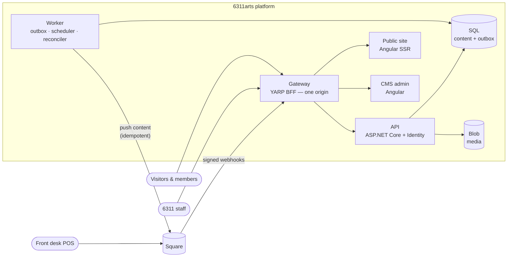

# 6311arts.com — Project Rogers Edge

The rebuild of **[6311arts.com](https://6311arts.com)** for 6311arts, a nonprofit art center at 6311 N. Clark St. in Chicago's Rogers Edge / Edgewater neighborhood. It has a gallery, a shop of local artists' work, and classes taught by local artists.

The site is moving off WordPress and its plugins onto:

- an **Angular SSR public site** and a **closed mini CMS**
- an **ASP.NET Core** API behind a **YARP gateway**
- **two-way sync with Square** for the shop, classes and memberships
- orchestration by **Aspire**

It runs **entirely on a developer laptop** until it's published to **Azure Container Apps**.

> **Status (2026-10-19):** The repo now has its target layout (prompt 0.1). The public site lives in `src/web/projects/site`. It was migrated unchanged from the `spike0` prototype and still reads WordPress until Phase 3. There's no .NET code yet. Phase 1 adds it.

---

## Architecture at a glance



**How it works:**

- **Staff edit content in the CMS.** The change and an **outbox** message are saved together, and the Worker pushes the content to Square.
- **Square owns money and stock.** When a price, stock level, sale or subscription changes in Square, a signed webhook updates the site.
- **Visitors pay on the page** through Square's Web Payments SDK. Card data never touches our servers.

The full picture, with containers, the request seam, the outbox, Square sync, identity, data model, flows, environments and decisions, is in **[docs/architecture/architecture.md](docs/architecture/architecture.md)**.

---

## Repository layout

**Today:**

```text
.claude/                 Claude Code toolkit: rules, skills, reviewer agents, hooks, settings
.github/workflows/       CI (Azure Static Web Apps preview of the site, until Phase 6)
CLAUDE.md                Project memory (SCRUB form), loaded every Claude Code session
docs/
  adr/                   Architecture decision records
  architecture/          High-level architecture (this repo's design reference)
  plans/square/          Square two-way integration plan (effort, Azure, costs)
  prompts/               SCRUB build prompts + WordPress import prompts
  runbooks/              Operating runbooks
src/
  web/                   Angular 22 workspace
    projects/site/       Public site, SSR (migrated from spike0; still WordPress-backed)
      legacy/            WordPress plugin, kept as importer reference only
```

**Target (after Phase 1 and Phase 2):**

```text
src/
  Arts6311.AppHost/          Aspire application model: laptop (run) + Azure (publish)
  Arts6311.ServiceDefaults/  Telemetry, health, resilience, service discovery
  Arts6311.Gateway/          YARP BFF: session, CSRF, internal token, edge policy
  Arts6311.Api/              Controllers only + Square webhook intake
  Arts6311.Domain/           Modules (Artists, Classes, Shop, …) + shared kernel (Outbox, Idempotency, …)
  Arts6311.Square/           The only code that talks to Square (official SDK)
  Arts6311.SquareFake/       Local Square stand-in, offline by default
  Arts6311.Worker/           Outbox dispatcher, scheduled publishing, reconciler
  Arts6311.MigrationService/ Applies migrations and seeds before anything starts
  Arts6311.Importer/         WordPress → snapshot → blob + database
  Arts6311.Tests/
  web/                       Angular workspace: projects/site (SSR), projects/admin (CMS), projects/ui (@6311/ui)
```

---

## Getting started

### Prerequisites

- .NET 10 SDK and the [Aspire CLI](https://aspire.dev)
- Node 22.22.3+ or 24.15+ (Angular CLI 22 requirement)
- Docker or another OCI container runtime
- [Claude Code](https://claude.com/claude-code), to build with the prompts

No Azure subscription or Square account is needed to run locally.

### Run

```bash
aspire run          # placeholder: the AppHost arrives in Phase 1
```

- **Opening it:** open the **gateway** URL from the Aspire dashboard. Everything (site, `/admin`, `/api`) is served from that one origin. Don't browse the apps on their own ports.
- **First run:** SQL, Redis, Azurite, Mailpit and the Square fake start as local containers. All secrets are generated and saved to your user-secrets automatically.
- **Real Square (optional):** to test against the Square **sandbox**, set `Square:Mode=sandbox` and follow `docs/runbooks/square-sandbox.md` (written in prompt 5.20).

### Until Phase 1: build the site on its own

```bash
cd src/web
npm ci
npm run build                  # SSR build → src/web/dist/site
npm run serve:ssr:site         # http://localhost:4000
```

### Everyday commands

| Task | Command |
|---|---|
| Whole system | `aspire run` (Phase 1+) |
| Build (.NET) | `dotnet build -warnaserror` |
| Tests (.NET) | `dotnet test` (see `CLAUDE.md` if xunit v3 reports zero tests) |
| Add a migration | `dotnet ef migrations add <Name> --project src/Arts6311.Domain --startup-project src/Arts6311.Api` |
| Frontend | `cd src/web && npm ci && npm run build && npm test` (Vitest; the `test` target isn't set up yet) |
| Inspect the Azure publish output | `aspire publish` (deploys run only in CI) |

---

## How this gets built: Claude Code + SCRUB

The platform is built with Claude Code, one small, reviewable prompt at a time.

**Every prompt follows the same SCRUB shape:**

- **S**cope
- **C**onstraint
- **R**estriction
- **U**tilization
- **B**ehavior

Claude plans, waits for approval, builds, tests and reports.

**Where things live:**

| | |
|---|---|
| **[CLAUDE.md](CLAUDE.md)** | The project's constitution: stack, layout, seams, field ownership, restrictions |
| **[.claude/](.claude/README.md)** | 13 path-scoped **rules**, 19 **skills** (e.g. `add-endpoint`, `add-outbox-message`, `add-square-sync`, `add-import-mapping`), 8 read-only **reviewer agents** (architecture, outbox, integration, security, API contract, design, test gaps, toolkit), and **hooks** that block secrets and format code |
| **[docs/prompts/scrub-prompts.md](docs/prompts/scrub-prompts.md)** | The build sequence, with operational templates |
| **[docs/prompts/wordpress-import-scrub-prompts.md](docs/prompts/wordpress-import-scrub-prompts.md)** | Moving WordPress content and media into the new platform |

### The build sequence

| Phase | What it delivers |
|---|---|
| **0 — Repo & toolkit** | Restructured repo, toolkit installed, baseline ADRs |
| **1 — Local platform** | Aspire, SQL, Redis, Azurite, Mailpit; Domain kernel; **transactional outbox** + Worker; idempotency; API with internal-token auth; YARP gateway; Identity; BFF session; staff 2FA; CI |
| **2 — CMS core** | `@6311/ui`; admin shell; media (blob + renditions); artists, exhibitions, pages, redirects; publishing, scheduling, previews; classes, shop items, plans (content); forms |
| **3 — Public site** | Site read API; the site rewired from WordPress to the API with SEO parity; publish-to-page check |
| **4 — WordPress import** | Snapshot → stage → load media and content → verify; delta refresh; cutover freeze |
| **5 — Square** | Integration records; gateways; Square fake; outbound push; webhook intake; inbound catalog and inventory; classes and seats; plans; sync admin; reconciler; cart, quote and on-site checkout; member accounts, signup and subscription webhooks; sandbox end-to-end |
| **6 — Azure** | Container Apps publish model; dev deploy from CI (GitHub OIDC); production hardening and cutover |

---

## Principles that don't bend

- **Square owns money and stock; the CMS owns content.** Price and stock are sent to Square once, at creation, and never written from the CMS again.
- **Every side effect after a save is an outbox message.** Square calls, emails, image renditions and cache refreshes all go through it. Nothing calls an external service inline after saving.
- **Every Square write carries an idempotency key.** Webhooks are verified and deduplicated, and never trusted for state; the handler fetches the current state from Square.
- **One public origin.** Browsers hold only an `HttpOnly` session cookie. The API trusts only the gateway's short-lived internal token.
- **Runs offline on a laptop; publishes to Azure** from the same Aspire model. Deploys happen only in CI.

---

## Documentation

| Document | Purpose |
|---|---|
| [docs/architecture/architecture.md](docs/architecture/architecture.md) | High-level architecture with diagrams |
| [docs/plans/square/square-integration-plan.md](docs/plans/square/square-integration-plan.md) | Square integration plan, effort and Azure costs |
| [docs/prompts/scrub-prompts.md](docs/prompts/scrub-prompts.md) | Build prompts (Phases 0–6) and templates |
| [docs/prompts/wordpress-import-scrub-prompts.md](docs/prompts/wordpress-import-scrub-prompts.md) | Import prompts (I.1–I.14) |
| [docs/adr/README.md](docs/adr/README.md) | Decision records: index, statuses (`DECIDE`), template |
| [docs/runbooks/README.md](docs/runbooks/README.md) | Runbooks: planned list and template |
| [src/web/projects/site/README.md](src/web/projects/site/README.md) | The public site as migrated from the spike |
| [CLAUDE.md](CLAUDE.md) · [.claude/README.md](.claude/README.md) | Project memory and toolkit guide |

---

## Project

Architected and delivered by **Robert Felkins, [Architect4Hire](https://architect4hire.com)**, for 6311arts (client sponsor: Holly King).

The visual direction follows the CSoon template. Its commercial license must be confirmed for this use before launch (ADR 0010).
