# 6311arts — High-Level Architecture

**Project:** Rogers Edge — rebuild of 6311arts.com
**Status:** Target architecture. Implementation follows [`docs/prompts/scrub-prompts.md`](prompts/scrub-prompts.md).
**Owner:** Robert Felkins (Architect4Hire) · Client sponsor: Holly King
**Last reviewed:** 2026-10-18

This document is the picture. The enforceable detail lives in [`CLAUDE.md`](../CLAUDE.md) and [`.claude/rules/`](../.claude/rules). If they disagree, the rules win, and this document gets fixed.

---

## Contents

1. [Goals and constraints](#1-goals-and-constraints)
2. [System context](#2-system-context)
3. [Containers](#3-containers)
4. [The request seam and domain modules](#4-the-request-seam-and-domain-modules)
5. [The transactional outbox](#5-the-transactional-outbox)
6. [Square two-way integration](#6-square-two-way-integration)
7. [Identity and the browser boundary](#7-identity-and-the-browser-boundary)
8. [Content model and lifecycle](#8-content-model-and-lifecycle)
9. [Key flows](#9-key-flows)
10. [WordPress import](#10-wordpress-import)
11. [Environments: laptop and Azure](#11-environments-laptop-and-azure)
12. [Cross-cutting concerns](#12-cross-cutting-concerns)
13. [Decisions and open items](#13-decisions-and-open-items)

---

## 1. Goals and constraints

| Goal                               | How the architecture answers it                                                                                           |
| ---------------------------------- | ------------------------------------------------------------------------------------------------------------------------- |
| Get off WordPress plugin sprawl    | A **closed** CMS: every content type is code we own. No plugins, themes or page builder.                                  |
| Staff publish without a developer  | Angular admin with draft, schedule, publish and preview. Publishing refreshes the site automatically.                     |
| Sell art, classes and memberships  | **Square** owns money and stock. The site sells on-page through the Web Payments SDK. Two-way sync keeps both sides true. |
| Never lose a sync or double-charge | **Transactional outbox** (atomic with every write), idempotency keys on every Square call, a webhook inbox, a reconciler  |
| Fast, findable public site         | Angular **SSR**. The spike's SEO (meta, JSON-LD, sitemap, 301s) is carried forward, with CDN-friendly caching.            |
| Cheap to run, easy to hand over    | Small Azure Container Apps footprint that scales to zero in dev. One Aspire model runs the laptop and Azure.              |
| Build fast and safely with AI      | Claude Code driven by SCRUB prompts, with rules, skills, reviewers and hooks in `.claude/`                                |

**Hard constraints:**

- Runs **fully on a developer laptop**, offline by default, until it's published to Azure.
- Square is reached **only** through `Arts6311.Square`.
- Card data never touches our servers.
- One public origin, through the gateway.

---

## 2. System context

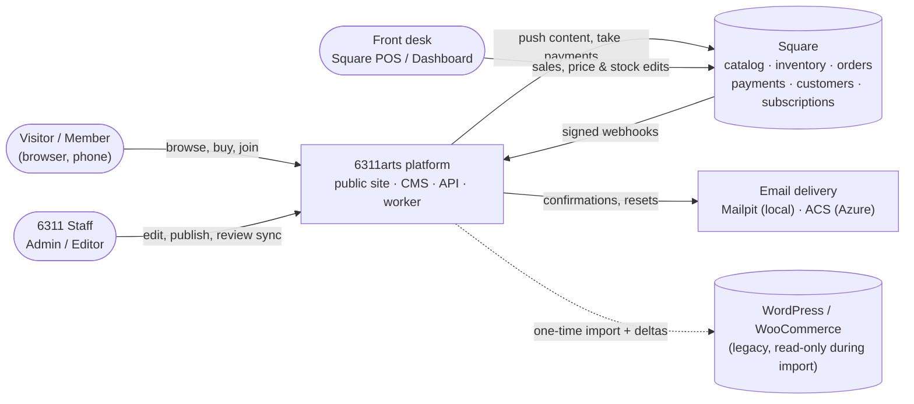

Square is shared with the front desk. In-person sales and price changes made there flow back to the website through webhooks.

---

## 3. Containers

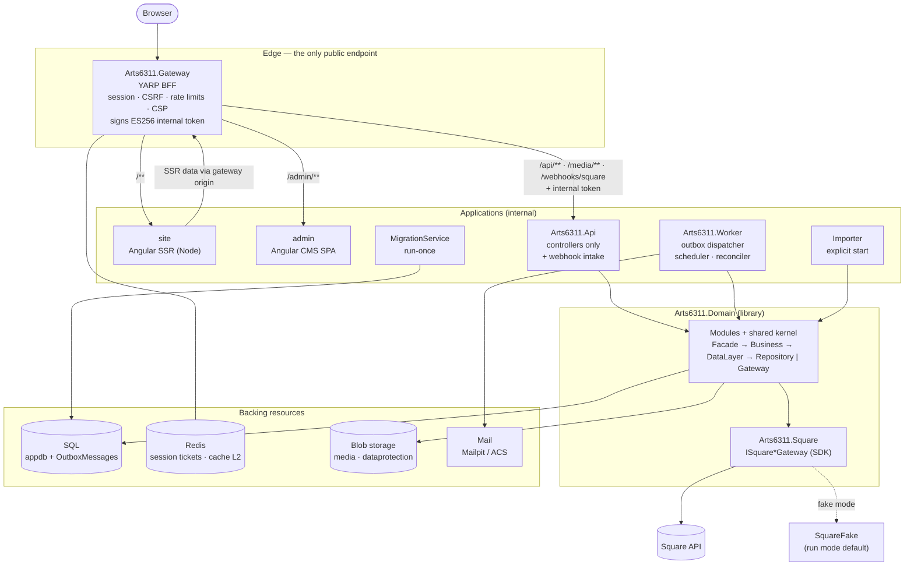

| Container            | Responsibility                                                                                     | Never does                                                                 |
| -------------------- | -------------------------------------------------------------------------------------------------- | -------------------------------------------------------------------------- |
| **Gateway**          | Routing, BFF session, antiforgery, header stripping, internal token, CSP, rate limits, compression | Business logic, data access, Square calls                                  |
| **site**             | SSR pages, SEO, JSON-LD, sitemap, legacy redirects, cart and checkout UI (Web Payments SDK)        | Hold secrets; call anything but the gateway                                |
| **admin**            | CMS screens, media library, sync and import operations views                                       | Store tokens; edit Square-owned values                                     |
| **Api**              | HTTP surface: controllers → facades; webhook intake (verify → inbox → outbox)                      | Domain logic; provider calls inside a request that could follow the commit |
| **Worker**           | Drains the outbox (keyed handlers), runs scheduled publishing and the reconciler, plus cleanup     | Accept HTTP traffic                                                        |
| **Domain**           | All modules, the shared kernel, `ArtsDbContext`, migrations                                        | Reference the Square SDK                                                   |
| **Square**           | Implements `ISquare*Gateway` with the official SDK; money mapping                                  | Leak SDK types                                                             |
| **MigrationService** | Apply migrations, seed, exit, before api and worker start                                          | Run in the request path                                                    |
| **Importer**         | WordPress → snapshot → stage → load through facades → verify                                       | Write WordPress; publish; call Square (except the read-only match)         |

---

## 4. The request seam and domain modules

Every HTTP feature and every worker handler follows one seam (`.claude/rules/backend.md`):

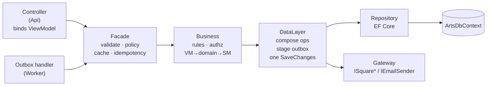

- **ViewModels in, ServiceModels out.** EF entities and Square DTOs never cross the controller boundary.
- **Handlers re-enter through facades.** Worker outbox handlers go through the same facades as controllers, so rules and validation apply in both places.

**Domain modules** (`Modules/<Context>/`, one assembly, one `DbContext`):

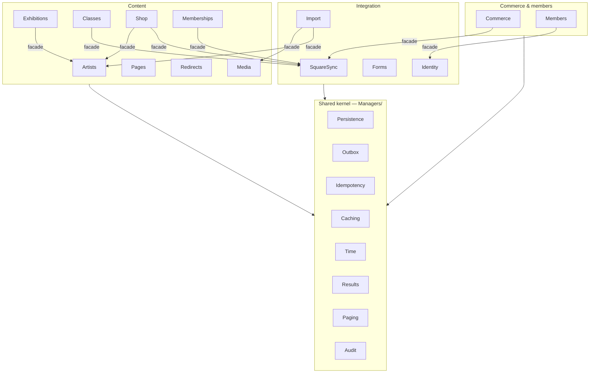

- **Cross-module traffic is facade to facade only.**
- **The shared kernel depends on no module.**
- **`ModuleBoundaryTests` enforce both rules.**

---

## 5. The transactional outbox

Every side effect that must follow a commit is an outbox message:

- Square pushes and seat adjustments
- processing inbound webhooks
- emails
- media renditions
- site revalidation

The SQL table **is** the queue, so there's no broker. The pattern is adopted from creatorpantry (`.claude/rules/outbox.md`).

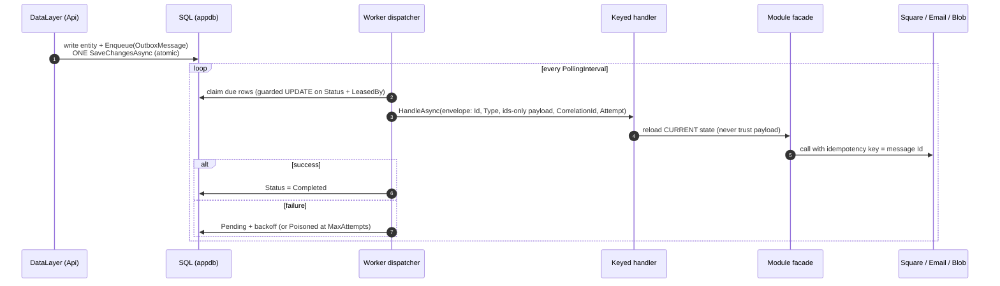

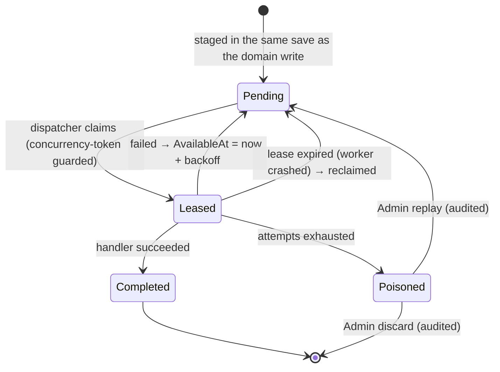

| Message type                                          | Raised by                                      | Handled by                                            |
| ----------------------------------------------------- | ---------------------------------------------- | ----------------------------------------------------- |
| `square.catalog-push-requested` / `-delete-requested` | Publish / update / archive of a synced type    | SquareSync: push current content to Square            |
| `square.inventory-adjust-requested`                   | Audited seat adjustment                        | SquareSync                                            |
| `square.webhook-received`                             | Webhook intake (after inbox insert)            | SquareSync / Members: fetch current state from Square |
| `media.rendition-requested`                           | Upload / import                                | Media: 400 / 800 / 1600 WebP + JPEG                   |
| `email.send-requested`                                | Forms, Identity, checkout, renewals            | Notifications via `IEmailSender`                      |
| `site.revalidate-requested`                           | Any publish change or Square projection change | Cache-tag invalidation                                |

**Guarantees:**

- At-least-once delivery, with idempotent handlers.
- A crash at any point loses nothing and duplicates no external effect.
- Two Worker replicas are safe.

---

## 6. Square two-way integration

### Field ownership

| CMS-owned → pushed                                             | Square-owned → pulled (read-only in admin)                                |
| -------------------------------------------------------------- | ------------------------------------------------------------------------- |
| Name, description, artist, categories, images, publish/archive | Price *after creation*                                                    |
| Class details, session dates and times                         | Stock, seats remaining, sold out                                          |
| Membership plan copy and perks                                 | Plan price and cadence after creation                                     |
|                                                                | Orders, payments, refunds, customers, cards, subscriptions, member status |

A **starting** price and stock (or capacity) are sent exactly once, when the item is created in Square.

### Mapping

| CMS                              | Square                                                                                                              |
| -------------------------------- | ------------------------------------------------------------------------------------------------------------------- |
| `ShopItem`                       | `ITEM` + one `ITEM_VARIATION` (inventory tracked; one-of-a-kind = 1)                                                |
| `ClassOffering` / `ClassSession` | `ITEM` / one `ITEM_VARIATION` per session (inventory = seats)                                                       |
| `MembershipPlan`                 | `SUBSCRIPTION_PLAN` + `SUBSCRIPTION_PLAN_VARIATION`                                                                 |
| Images                           | `IMAGE`, uploaded by the push handler                                                                               |
| Link between them                | `SquareCatalogLink` (Square ids, version, content hash, status). The CMS id is stored as a Square custom attribute. |

### Two directions, one mechanism

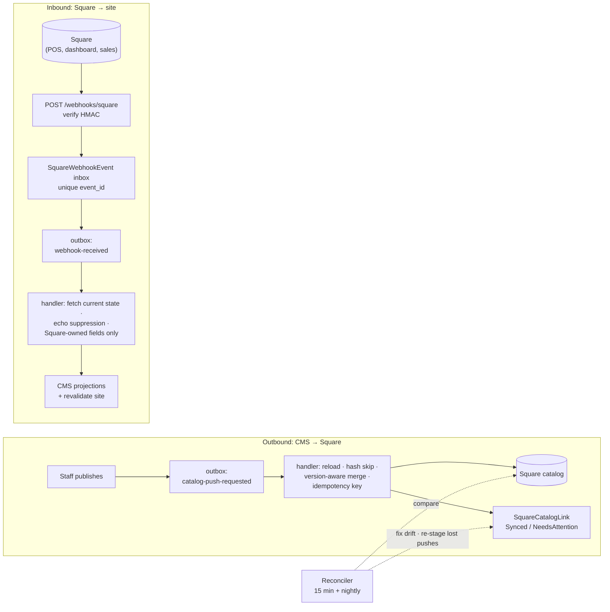

**Safety rules:**

- Webhook payloads are never trusted.
- Our own pushes echoing back are ignored.
- Objects created in Square become CMS drafts flagged for review.
- Objects deleted in Square are archived and flagged, never hard-deleted.
- In run mode, everything runs against `Arts6311.SquareFake` by default. Sandbox is opt-in, and production is unreachable.

---

## 7. Identity and the browser boundary

The gateway-to-API trust model is creatorpantry's baseline B-02/B-13, adopted as-is (`.claude/rules/auth.md`, `gateway.md`).

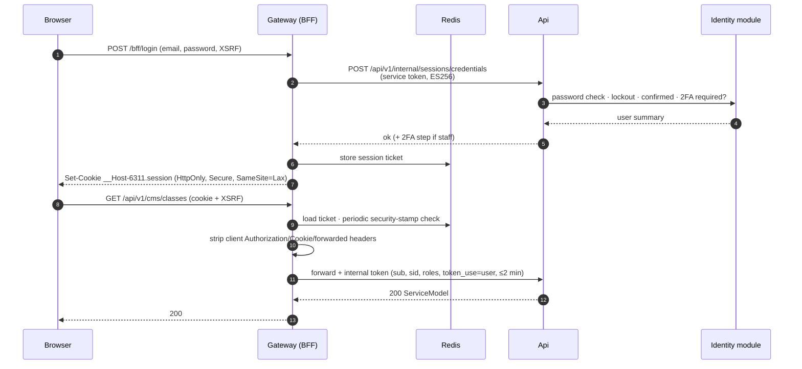

| Role      | Can                                                                                                       |
| --------- | --------------------------------------------------------------------------------------------------------- |
| `Admin`   | Everything, including deletes, seat adjustments, outbox replay/discard, users, redirects. Needs TOTP 2FA. |
| `Editor`  | CMS content and media. Needs TOTP 2FA.                                                                    |
| `Member`  | Member area: subscription status, card update, cancel                                                     |
| anonymous | Public site reads, cart, quote, pay, forms (rate limited)                                                 |

**Rules:**

- No tokens ever reach the browser.
- `/api/v1/internal/**` returns 404 from browsers.
- The API accepts only the gateway's internal token.

---

## 8. Content model and lifecycle

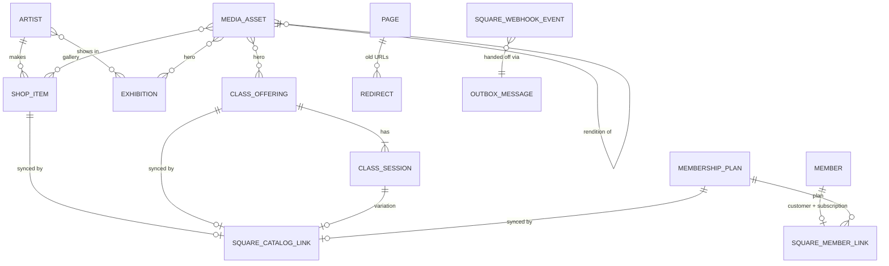

Publishable content (artists, exhibitions, classes, shop items, plans, pages) shares one lifecycle:

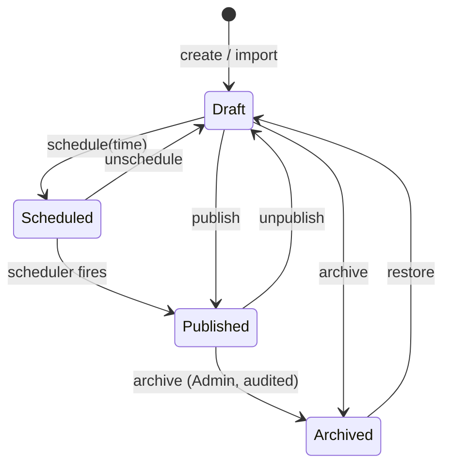

Every transition stages `site.revalidate-requested`. Synced types also stage the matching `square.*` message.

**Slugs** are immutable once published; a change creates a `Redirect`.

**Previews** use signed, expiring, `noindex` links.

---

## 9. Key flows

### 9.1 Page render (SSR)

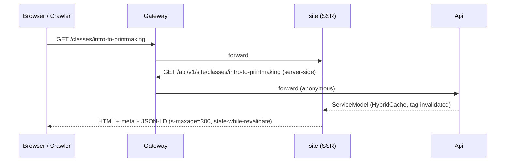

### 9.2 Checkout (Web Payments SDK)

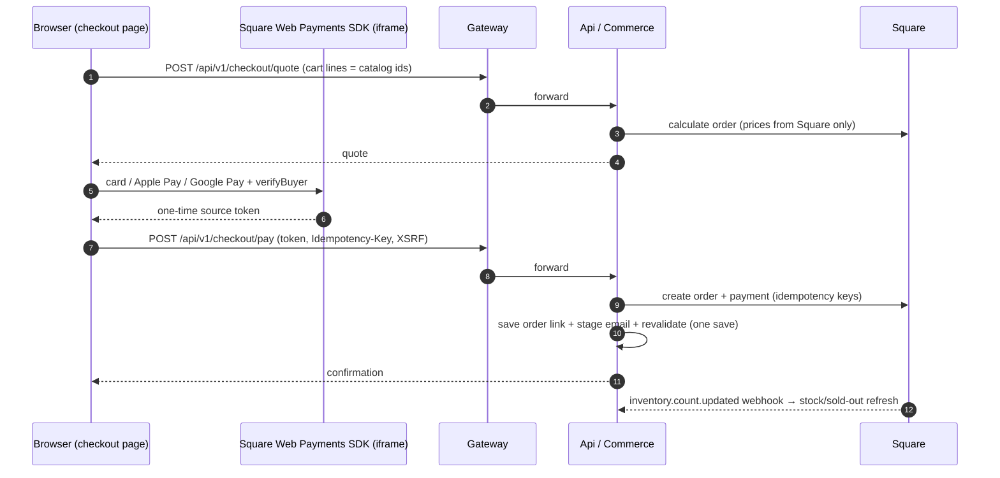

Amounts never come from the browser. The token is used once and never stored. CSP allows Square's origins only on checkout routes.

### 9.3 Membership signup

The member signs in (Member role) and the SDK tokenizes the card. Then the API:

1. finds or creates the Square customer
2. stores the card on file
3. creates the subscription (an idempotent command)

Member status stays **Pending** until `subscription.*` webhooks confirm it. Renewal failures arrive through invoice and payment webhooks, which flag the member and stage an email.

---

## 10. WordPress import

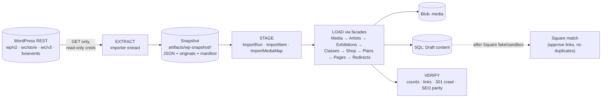

**How the import behaves:**

- **Immutable snapshots.** Every run reads a snapshot that's never changed after it's written.
- **Idempotent.** Records are keyed on their WordPress id. Staff-edited records are flagged for review, never overwritten.
- **Drafts only.** Everything lands as Draft. WooCommerce prices and stock fill only the *starting* fields.

Details are in `.claude/rules/import.md` and [`docs/prompts/wordpress-import-scrub-prompts.md`](prompts/wordpress-import-scrub-prompts.md).

---

## 11. Environments: laptop and Azure

One Aspire AppHost describes both. Azure-shaped resources run as containers or emulators locally.

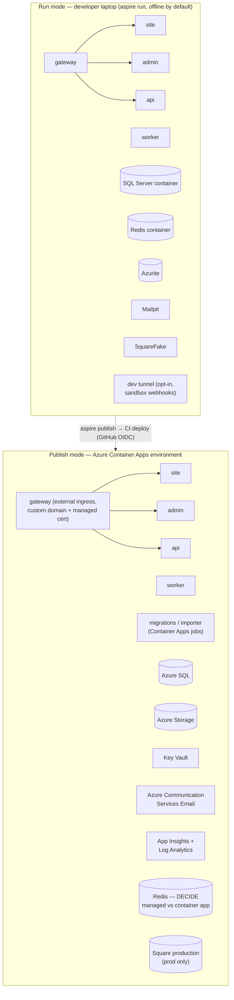

|         | Laptop (run mode)        | Azure dev                      | Azure prod                        |
| ------- | ------------------------ | ------------------------------ | --------------------------------- |
| Square  | Fake (default) / sandbox | Sandbox                        | Production                        |
| Scaling | n/a                      | Scale to zero (except gateway) | Min 1: gateway, api, site, worker |
| Secrets | Generated + user-secrets | Key Vault                      | Key Vault                         |
| Deploy  | —                        | CI on `main`                   | CI with manual approval           |

**Rough hosting cost** (from the Rogers Edge plan; the outbox replaced Service Bus):

- about $20/mo for dev
- about $85–100/mo for prod
- plus Redis (DECIDE: about $15–20/mo managed, or a few dollars as a container app)
- plus Square fees per sale

---

## 12. Cross-cutting concerns

| Concern             | Approach                                                                                                                                                                                                            |
| ------------------- | ------------------------------------------------------------------------------------------------------------------------------------------------------------------------------------------------------------------- |
| **Observability**   | OpenTelemetry via ServiceDefaults. `CorrelationId` flows browser → gateway → api → outbox row → handler → Square. Alerts: Poisoned > 0, outbox age > 5 min, webhook signature failures, 5xx rate.                   |
| **Caching**         | HybridCache (in-memory L1, Redis L2) with tags invalidated by `site.revalidate-requested`. SSR `s-maxage` + `stale-while-revalidate` at the edge.                                                                   |
| **Resilience**      | ServiceDefaults resilience on HTTP clients. Square writes only from outbox handlers (retry with backoff → poison → admin replay). Reconciler as the safety net.                                                     |
| **Security**        | Single origin; BFF cookie; antiforgery; ES256 internal token; header stripping; rate limits; CSP scoped to checkout; HTML sanitizer; signature-checked uploads; no public blobs; TOTP for staff; secret-guard hook. |
| **Data protection** | No card data stored. Newsletter imported only with consent. Customer passwords never migrated. Snapshots with personal data deleted after cutover.                                                                  |
| **Contracts**       | `/api/v1`; ProblemDetails with stable codes; `ETag`/`If-Match`; `Idempotency-Key`; OpenAPI snapshot test; Angular models checked against it.                                                                        |
| **Testing**         | Per-layer tests (mock the layer below); real-DB outbox atomicity tests; Square contract suite against the fake (sandbox opt-in); Aspire end-to-end test; Playwright for UI and redirects.                           |
| **Delivery**        | Claude Code + SCRUB prompts; `.claude/` rules, skills, read-only reviewers and hooks. Deploys only via CI.                                                                                                          |

---

## 13. Decisions and open items

| ADR  | Decision                                                                       | Status                            |
| ---- | ------------------------------------------------------------------------------ | --------------------------------- |
| 0001 | Single-origin YARP gateway as BFF (custom host, not the Aspire YARP container) | Decided                           |
| 0002 | Gateway session + ES256 internal token; no OIDC server                         | Decided (creatorpantry B-02/B-13) |
| 0003 | SQL transactional outbox; no message broker                                    | Decided                           |
| 0004 | Module-first Domain + mandatory seam                                           | Decided                           |
| 0005 | Square field ownership                                                         | Decided                           |
| 0006 | Square ids in `SquareCatalogLink`, not entities                                | Decided                           |
| 0007 | Square fake by default, sandbox opt-in                                         | Decided                           |
| 0008 | Run mode offline; publish to Azure Container Apps                              | Decided                           |
| 0009 | Redis hosting in Azure (managed vs container app)                              | **DECIDE** (Phase 6.1)            |
| 0010 | CSoon template license covers this use                                         | **DECIDE** before launch          |
| 0011 | Square archive policy (delete vs mark unavailable)                             | **DECIDE** (5.5)                  |
| 0012 | Square subscription limits (no ACH, $1 minimum)                                | Record (5.10)                     |
| 0013 | Member class discount mechanism                                                | **DECIDE** (5.19)                 |
| —    | Newsletter vendor (export only until chosen)                                   | **DECIDE**                        |

ADRs live in `docs/adr/` and are created by prompt 0.3 and the prompts named above.
