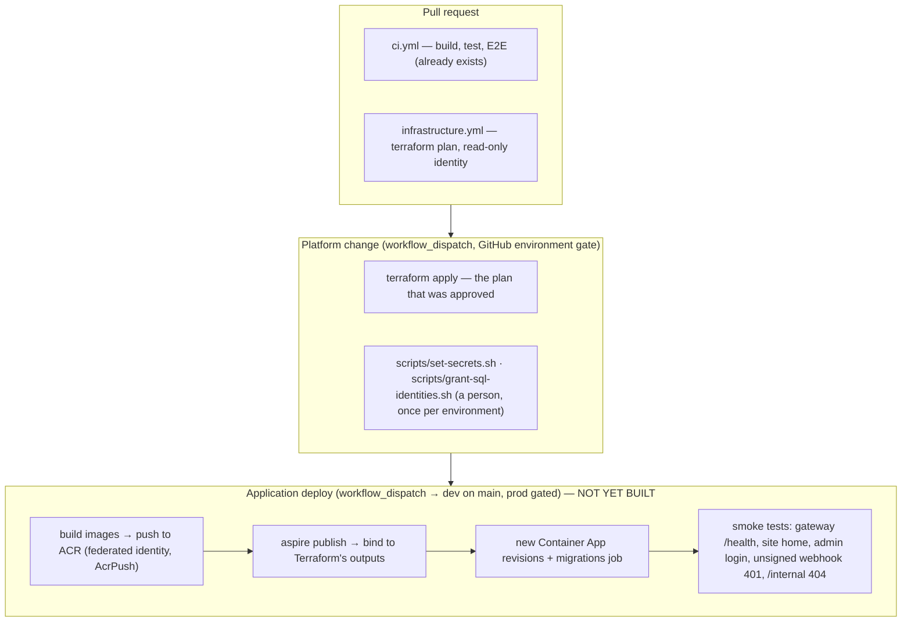

# Infrastructure and CI/CD on Azure

How 6311arts gets from a laptop to Azure Container Apps, who owns which half of that, and what still has to
be built before the first real deploy. The Terraform that implements the platform half is in
[`infra/terraform/`](../../infra/terraform/), with its command sheet in
[`infra/terraform/README.md`](../../infra/terraform/README.md).

- **Status:** the platform is written and unapplied. No Azure resource exists yet.
- **Related:** ADR 0008 (run offline, publish to Container Apps), ADR 0001 (the gateway is the only public
  origin), ADR 0009 (Redis), ADR 0014 (the temporary Static Web Apps review copy), prompts 6.1-6.3 in
  [`docs/prompts/scrub-prompts.md`](../prompts/scrub-prompts.md).

---

## 1. Who owns what

ADR 0008 makes `Arts6311.AppHost` the single source of truth for the application model, in both run mode and
publish mode. Terraform does not change that. It owns the **platform** — the long-lived, stateful, expensive
things that outlive any one revision — and the AppHost keeps owning the **applications**.

| | Terraform (`infra/terraform/`) | Aspire (`Arts6311.AppHost`) |
|---|---|---|
| Resource group, Container Apps environment, Log Analytics, Application Insights | ✅ | |
| Container registry | ✅ | |
| Azure SQL server + `appdb`, storage (`media`, `dataprotection`), Managed Redis, Communication Services | ✅ | |
| Key Vault and every secret the apps read | ✅ | |
| One managed identity per app, and its role assignments | ✅ | |
| The five Container Apps (`gateway`, `api`, `site`, `admin`, `worker`) | | ✅ |
| The `migrations` and `importer` jobs | | ✅ |
| Ingress, scaling rules, revisions, environment variables | | ✅ |

The reason to split it this way rather than put everything in one tool: the application topology — which
app waits for which, what each one references, which gets external ingress — is already described once, in
C#, and tested by the end-to-end test (ADR 0026). Describing it a second time in HCL means two descriptions
that drift. Whereas the platform has a lifecycle Aspire has no opinion about: a database with a 35-day
restore window and `prevent_destroy` on it is not something a deploy should ever recreate.

> This split is a decision that needs recording. See [§10](#10-what-needs-an-adr).

---

## 2. The pipeline



Three rules hold across all of it:

- **No cloud credential is stored in GitHub.** Every job exchanges its own short-lived GitHub OIDC token
  for an Azure token. The federated credential's subject is `repo:<owner>/<repo>:environment:<name>`, so a
  token is only issued to a job that declares that environment — which is also where the approval gate
  lives. Removing the gate does not bypass it, it breaks authentication.
- **Nothing applies on a push.** A pull request gets a read-only plan from an identity that holds `Reader`.
  Changing Azure is always `workflow_dispatch`.
- **No deploy from a Claude session.** `aspire deploy` and `azd` are denied in `.claude/settings.json`
  (CLAUDE.md "Hygiene"). That is unchanged by any of this.

---

## 3. State and the resource groups

State lives in its own resource group, created once by `infra/terraform/bootstrap`:

```text
rg-6311arts-tfstate
└── st6311artstfstate<suffix>        GRS, versioning + 30-day soft delete
    └── tfstate/                     private
        ├── dev.tfstate
        └── prod.tfstate
```

- **Shared keys are switched off entirely.** The backend and the provider both reach the data plane with
  Entra ID (`use_azuread_auth = true`, `storage_use_azuread = true`). There is no account key to leak.
- **GRS and versioning** because state is the one thing here that cannot be rebuilt from the repository. A
  bad apply or a truncated write is rolled back to the previous blob version.
- **Treat read access to that container as read access to secrets.** Terraform state holds resource
  attributes, and for this configuration that includes the Managed Redis access key. It is also why the
  plan file is never uploaded as a workflow artifact.

Bootstrap also creates `rg-6311arts-dev` and `rg-6311arts-prod`, and that is deliberate: it is what lets
each CI identity be scoped to one resource group instead of the subscription. Four identities exist, two
per environment:

| Identity | Federated subject | Can |
|---|---|---|
| `id-6311arts-gh-<env>-plan` | `…:pull_request` | `Reader` on the group; read and lease the state blob |
| `id-6311arts-gh-<env>-deploy` | `…:environment:<env>` | `Contributor`, `Role Based Access Control Administrator`, `Key Vault Secrets Officer`, `AcrPush` — on that group only |

Bootstrap is also where every resource provider is registered, because registration is a subscription-level
action that an RG-scoped `Contributor` cannot perform. azurerm 5.x registers nothing by default (4.x
registered about sixty), so this is not optional.

---

## 4. The handshake

`terraform output` is the contract between the two halves. The deploy step reads it and binds the Aspire
model's Azure resources to the ones that already exist, rather than provisioning its own.

| Output | Feeds |
|---|---|
| `container_app_environment_id` | `AddAzureContainerAppEnvironment("aca").PublishAsExisting(...)` |
| `container_registry_login_server` | where the image build pushes |
| `sql_server_fqdn`, `sql_database_name` | `ConnectionStrings__appdb`, already written to Key Vault |
| `storage_account_name` | `ConnectionStrings__blobs` — a service URI, not a credential |
| `redis_hostname` | `ConnectionStrings__cache` |
| `key_vault_uri`, `secret_names` | every secret reference the apps are given |
| `app_identity_ids` | the identity assigned to each Container App |
| `app_identity_client_ids` | each app's own `AZURE_CLIENT_ID` |
| `gateway_url` | the Square webhook URL, `Email__SiteOrigin`, `site_allowed_hosts` |
| `app_settings` | the non-secret configuration, resolved per environment |

`AZURE_CLIENT_ID` is the one lever worth understanding: it is what makes `DefaultAzureCredential` pick
*that* app's identity for blob access and for the Entra connection to SQL, rather than guessing among the
identities attached to the container.

---

## 5. Secrets

Nothing the applications read is ever an environment variable in a template, a value in a workflow, or a
line in a log. Every one is a Key Vault reference resolved by the app's own managed identity.

Secrets come in two kinds, and Terraform treats them differently:

**Values Azure produces** — the Application Insights connection string, the Redis access key, the
Communication Services key. Terraform has to read these to write them, so they are in state. Hence §3.

**Values a person or the application generates** — the ES256 signing pair (ADR 0002), the idempotency HMAC
key (ADR 0020), the seeded admin password, the site's SSR credential (prompt 6.1), and the Square
credentials. Terraform creates an empty **shell** for each and then ignores its value for ever
(`lifecycle { ignore_changes = [value] }`). The real value is set out of band by
`infra/terraform/scripts/set-secrets.sh`, which generates what can be generated and prompts for the rest.
**No application secret enters Terraform state, a plan, or a workflow.**

The placeholder is deliberately not a weak-but-valid value. A revision deployed before the secrets are set
fails to start — the gateway cannot parse `REPLACE-ME` as a PEM — rather than quietly signing internal
tokens with something guessable.

Two things Terraform structurally cannot do, both scripted beside it:

1. **Create the SQL database users.** The server is Entra-authentication-only, with no SQL login and no
   password at all. `CREATE USER [...] FROM EXTERNAL PROVIDER` is T-SQL run inside the database by a member
   of the admin group — `scripts/grant-sql-identities.sh`. Until it has run, every connection fails with
   *Login failed for user '\<token-identified principal\>'*, which is the most common way a first deploy to
   a new environment fails.
2. **Verify a custom email domain.** Terraform creates it unverified; the TXT, SPF and DKIM records it
   reports have to be published on the real domain first.

---

## 6. Environments

|  | dev | prod |
|---|---|---|
| Container Apps | scale to zero except the gateway | min 1 for gateway, api, site, worker |
| SQL | serverless, 0.5 vCore, 7-day PITR | serverless, min 1, never paused, 35-day PITR + weekly/monthly LTR |
| Storage | LRS | ZRS, 30-day blob soft delete |
| Redis | `Balanced_B0`, no persistence, no replica | `Balanced_B0`, AOF every second, replica |
| Key Vault | no purge protection, 7-day soft delete | purge protection on, 90 days |
| Email | Azure-managed domain only, `staff@6311arts.localhost` | custom domain, the centre's real inbox |
| Square | sandbox | production |
| Logs | 30 days, 1 GB/day cap | 90 days, uncapped |
| Deploy | `workflow_dispatch`, no reviewers | `workflow_dispatch`, environment reviewers |

Non-production environments cannot email a stranger, by construction: the sending domain is the
Azure-managed `donotreply@<guid>.azurecomm.net`, which is rate limited, and `forms_staff_email` is a
non-routable `.localhost` address everywhere but prod (ADR 0047).

---

## 7. Cost

Two findings change the numbers in [`docs/architecture/architecture.md`](../architecture/architecture.md)
§11, and both need pricing against the calculator before the first apply — the figures there (about $20/mo
dev, $85-100/mo prod, plus $15-20/mo Redis) predate them.

**Azure Cache for Redis can no longer be created.** Creation of the Basic, Standard and Premium tiers was
blocked for existing subscriptions on **2026-10-01**, ahead of retirement on **2028-09-30**; Azure Managed
Redis is the replacement. So the ~$16/mo `C0` instance the architecture document costed does not exist as an
option. `Balanced_B0` is the smallest Managed Redis SKU and is materially more expensive. This is the single
biggest change to the hosting estimate.

**Azure SQL serverless will not auto-pause.** `Arts6311.Worker` polls the outbox continuously — the SQL
outbox *is* the queue (ADR 0003) — so a running worker holds a connection open and the database never
pauses. Serverless bills a higher rate per vCore-hour than provisioned precisely because it is meant to
pause. In dev, either scale the worker to zero when the environment is idle, or switch to a DTU SKU:
`sql_sku_name = "S0"` is a one-line change in `envs/dev.tfvars` and the serverless-only settings fall away
on their own.

Everything else is small: Container Apps consumption with scale-to-zero, a Basic registry, Log Analytics
under a 1 GB/day cap, and a Standard storage account.

---

## 8. Gaps in the application

The platform can be applied today. **The application cannot be deployed onto it today.** Each of these is
prompt 6.1's work, and each will fail a deploy if it is missing:

| Gap | What breaks without it |
|---|---|
| **Publish-mode AppHost** (`AddAzureContainerAppEnvironment`, Key Vault references, a Node server for the site, a static host for the admin, migrations as a job) | there is nothing to deploy |
| **Forwarded headers at the gateway**, trusted only from the ACA ingress | the gateway sees HTTP, and `Secure` `__Host-` cookies and antiforgery refuse every unsafe request (ADR 0026) |
| **An ACS email sender.** `Arts6311.Worker` has one `IEmailSender`, `SmtpEmailSender`, pointed at Mailpit; the vault holds an ACS connection string, which is not SMTP | every password reset, confirmation and form notification (ADR 0023). Either add an ACS sender in the outbox handler, or use ACS SMTP relay, which needs an Entra app registration and a secret |
| **Entra authentication to SQL**, and the database users from `grant-sql-identities.sh` | every connection: the server accepts no password |
| **An Azure Monitor exporter, or ACA's OTel agent.** ServiceDefaults exports OTLP; the vault holds an App Insights connection string | no traces, so no "one trace from gateway to Square" |
| **The site's SSR rate-limit partition** (prompt 6.1) | every server-side read shares one per-IP `api` budget, so a crawl 429s the whole site (ADR 0046) |
| **Entra authentication to Redis** (optional) | nothing — access keys work. But it is why `access_keys_authentication_enabled` is on, and worth closing later |

Until the first and second of these land, the application-deploy workflow in §2 cannot be written in a form
that runs, which is why it is specified there and not committed. Writing it now would be fiction.

---

## 9. Open questions

- **Redis is one instance for two jobs.** Session tickets and the HybridCache L2 share it (ADR 0009, ADR
  0036, ADR 0049), and Managed Redis has one database per instance. `VolatileLRU`, Azure's default, evicts
  the least recently used key *with a TTL* — which is every cache entry and also every session ticket, so
  memory pressure can sign a visitor out mid-checkout. `NoEviction` fails the cache write instead. Neither
  is right; separating them needs a second instance and a second line on the bill. Set via
  `redis_eviction_policy`. **DECIDE.**
- **Public endpoints.** SQL, Key Vault, storage and Redis are all reachable from the internet, with
  authorisation doing the work and no network control beyond Azure's. Consumption Container Apps have no
  stable outbound address to allow instead; locking this down means a VNet-integrated environment, a
  subnet, and private endpoints. **DECIDE** — and it is a prod-hardening question (prompt 6.3), not a
  blocker for dev.
- **Where the gateway's custom domain and managed certificate are created.** They need DNS validation, so
  they cannot be a clean one-shot apply. Probably Terraform, after the DNS records exist. **DECIDE.**
- **Whether ADR 0014's Static Web Apps review copy goes away with the dev environment,** as that ADR says
  it should. It is a second public origin and a known exception to ADR 0001.

---

## 10. What needs an ADR

CLAUDE.md asks for an ADR per architectural decision. Two were taken in building this and are recorded:

- **ADR 0055 — Terraform owns the Azure platform, Aspire owns the applications.** The split in §1, and why
  it does not contradict ADR 0008.
- **ADR 0056 — Azure Managed Redis.** Resolves the open half of ADR 0009. Forced rather than chosen:
  Azure Cache for Redis can no longer be created.

---

## 11. Order of work

Owners as prompt 6.3 writes them: **you** for anything irreversible or outside the repository, **Claude**
for the rest.

| | Step | Owner |
|---|---|---|
| 1 | Review this plan and the Terraform; decide the open questions in §9 | you |
| 2 | Create the Entra SQL admin group; `terraform apply` in `bootstrap/` | you |
| 3 | Fill in `envs/dev.*` from bootstrap's outputs; set the GitHub variables and the `prod` reviewers | you |
| 4 | `terraform fmt -recursive`, then `plan` dev and read it | you |
| 5 | `apply` dev; run `set-secrets.sh` and `grant-sql-identities.sh` | you |
| 6 | Prompt 6.1: the publish model and the gaps in §8 | Claude, then you review |
| 7 | Prompt 6.2: the application-deploy workflow, the smoke tests, `docs/runbooks/azure-dev.md` | Claude |
| 8 | Register the dev gateway URL as the Square sandbox webhook URL | you |
| 9 | Prompt 6.3: prod — custom domain, certificates, alerts, cutover runbook, DNS switch | you, with Claude |

Teardown, for dev, is `terraform destroy -var-file=envs/dev.tfvars`. It will refuse to delete `appdb` and
the media storage account, because `prevent_destroy` is set on both. That is the intended answer: read why
before removing it.
