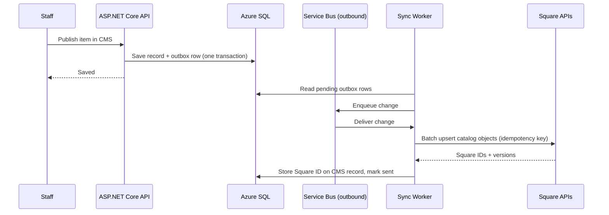
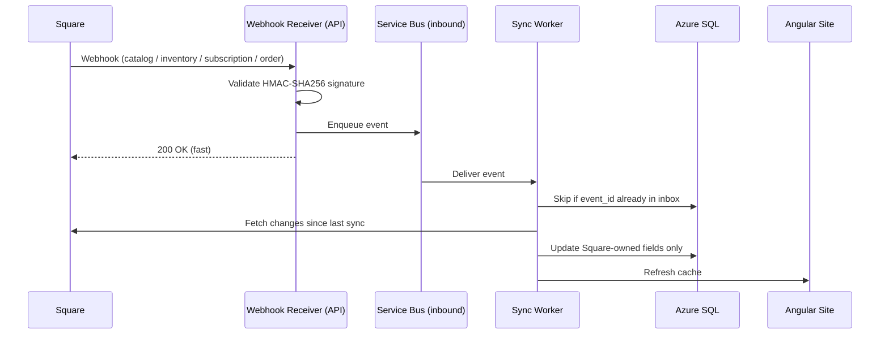
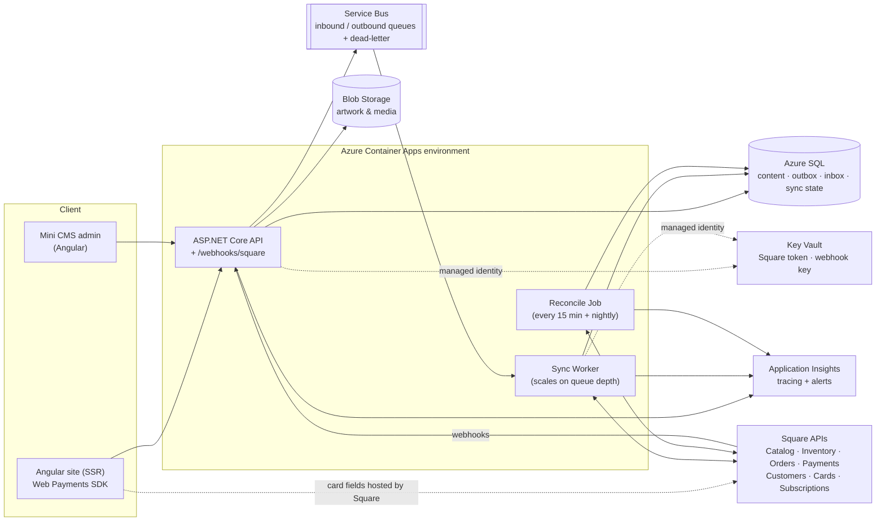
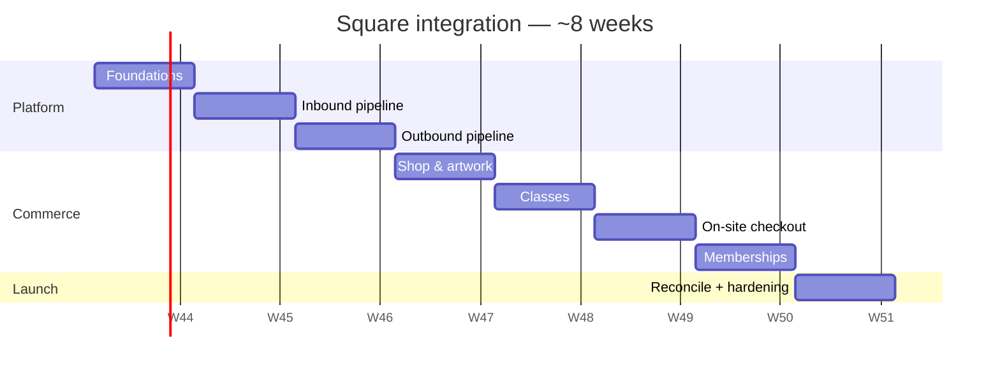

# Square Two-Way Integration — Architecture & Delivery Plan

**Project:** Rogers Edge — 6311arts.com rebuild
**Prepared for:** 6311 Arts · Client Sponsor: Holly King
**Architect:** Robert Felkins, Architect4Hire
**Delivery model:** Architect + Claude Code · $75/hr
**Status:** Draft · 2026-10-18

---

## Contents

- [Summary](#summary)
- [Scope](#scope)
- [Field ownership](#field-ownership)
- [How the sync works](#how-the-sync-works)
- [What each area syncs](#what-each-area-syncs)
- [Azure architecture](#azure-architecture)
- [Environments](#environments)
- [Effort & cost](#effort--cost)
- [Delivery sequence](#delivery-sequence)
- [Ongoing costs](#ongoing-costs)
- [Risks & decisions](#risks--decisions)
- [References](#references)

---

## Summary

The new Angular site and mini CMS stay in two-way sync with Square:

- **Site → Square:** when staff publish artwork, shop items, classes or membership plans in the CMS, they show up in Square.
- **Square → site:** when prices, stock, seats, orders or subscriptions change in Square, the website updates on its own.

Visitors pay through a card form on the site (Square Web Payments SDK). Card numbers never touch our servers.

| | |
|---|---|
| **Effort** | ~232 architect hours |
| **Cost** | ~$17,400 at $75/hr |
| **Timeline** | ~8 weeks at ~30 hrs/week |
| **Added Azure cost** | ~$15–20/mo prod · < $5/mo dev |

---

## Scope

**In scope**

- Shop items and artwork (catalog items, images, prices, stock)
- Classes and workshops (sessions and seat counts)
- Memberships (Square subscription plans and member status)
- On-site checkout (card, Apple Pay, Google Pay)
- Webhook handling, reconciliation, monitoring and runbooks

**Out of scope**

- Syncing orders and customers back into the CMS for reporting. Square stays the system of record for these.
- Square Appointments / Bookings.
- Refund handling on the site. Refunds are done in Square.
- In-person point-of-sale setup.

---

## Field ownership

Square's own guidance warns that two-way catalog sync is risky, because edits on both sides can clash, duplicate or overwrite each other. This design avoids that by deciding up front which side owns each field, so the two systems never fight over the same one.

| Owned by the **CMS** (pushed to Square) | Owned by **Square** (pulled into the site) |
|---|---|
| Titles, descriptions, artist, images, categories | Price |
| Publish / unpublish | Stock and seat counts, sold-out status |
| Class details and session dates | Orders, payments, refunds |
| Membership plan descriptions | Subscription status, billing, failed charges |

**Rule:** staff change prices and stock in **Square**. They change content in the **CMS**. If someone edits a description in Square, the next CMS publish overwrites it.

---

## How the sync works

### Site → Square (outbound)

- Saving in the CMS writes the record and an **outbox** row in the same database transaction. A change is never saved without being queued for Square.
- The worker pushes changes in **batches**. Every request carries an **idempotency key**, so retrying it never creates a duplicate.
- Each CMS record stores its Square ID. Each Square object gets a custom attribute holding the CMS ID, so either side can find its match.
- Images go up through Square's catalog image API.
- A failed push is retried. After repeated failures it moves to a **dead-letter queue** that staff can replay.

### Square → site (inbound)

- The receiver checks the `x-square-hmacsha256-signature` header, queues the event and replies at once.
- Webhooks can arrive **late, twice or out of order**. So the worker:
  - drops duplicates by `event_id` (the inbox table)
  - asks Square for the current state (catalog changes since the last sync, current stock counts) instead of trusting the webhook payload.
- **Echo protection:** Square also sends webhooks for changes our own pushes caused. The worker recognizes these by Square version or content hash and ignores them, so the two sides can't loop.

### Safety net (reconciliation)

- A Container Apps scheduled job compares the CMS against Square **every 15 minutes**, plus a **full comparison nightly**.
- It fixes anything a missed webhook would leave out of date, and logs every correction.

---

## What each area syncs

### Shop & artwork

- Each piece is a Square **catalog item** with stock tracking.
- One-of-a-kind art has a stock of **1** and shows **sold out** as soon as it sells, whether online or at the front desk.

### Classes & workshops

- Each class is an **item**, and each session is a **variation** of it.
- A session's **seat count is its stock**. Square decrements it with every sale, and the site shows seats remaining.
- Class rosters come from Square orders.

### Memberships

- Plans are created as Square **subscription plans** with plan variations for price and billing period.
- Signup on the site:
  1. The card is collected in the Web Payments SDK form.
  2. The customer is created in Square (Customers API).
  3. The card is saved to that customer (Cards API).
  4. The subscription is created (Subscriptions API).
- `subscription.*`, `invoice.*` and `payment.updated` webhooks keep member status current and flag failed renewals.
- Square's limits: no ACH / bank-account payments, and a **$1 minimum** charge.

### On-site checkout

- The **Square Web Payments SDK** handles card, Apple Pay and Google Pay. The card fields are hosted by Square.
- The site builds an order with the **Orders API** and charges it with the **Payments API**, using idempotency keys.
- Extra card verification (SCA / 3-D Secure) runs when the bank requires it.
- Receipts come from Square.

---

## Azure architecture

Builds on the Azure Container Apps setup in the Rogers Edge delivery plan.

| Component | Role |
|---|---|
| **Angular site (SSR)** | Public pages, cart, Web Payments SDK card form |
| **ASP.NET Core API** | CMS endpoints, checkout, membership signup, webhook receiver |
| **Sync Worker** (Container App) | Handles the inbound and outbound queues. Scales to zero when idle. |
| **Reconcile Job** (Container Apps job) | Scheduled comparison and correction |
| **Azure SQL** | Content, outbox, inbox (seen `event_id`s), sync cursor, Square ID map |
| **Service Bus (Basic)** | Durable queues with dead-letter |
| **Key Vault** | Square access token and webhook signature key, read through managed identity |
| **Application Insights** | End-to-end tracing of every sync, plus alerts |

### Alerts

- Dead-letter queue depth > 0
- Sync delay > 5 minutes
- Webhook signature failures
- Reconcile job corrections above a set threshold

---

## Environments

| | Dev | Production |
|---|---|---|
| Square | **Sandbox** application | **Production** application |
| Webhook subscription | Points at the dev API | Points at the prod API |
| Container Apps environment | Separate | Separate |
| Key Vault, Service Bus, SQL | Separate | Separate |

Square credentials and webhook keys are never shared between environments.

---

## Effort & cost

Architect + Claude Code at **$75/hr**.

| # | Workstream | Hours | Cost |
|---|---|---:|---:|
| 1 | **Square foundations:** sandbox and prod apps, Key Vault, SDK client, field-ownership mapping, design decision records | 16 | $1,200 |
| 2 | **Inbound pipeline:** webhook receiver and signature check, Service Bus, duplicate removal, fetching recent changes | 32 | $2,400 |
| 3 | **Outbound pipeline:** outbox and worker, batch pushes, image upload, deletes, retries and dead-letter handling | 32 | $2,400 |
| 4 | **Shop & artwork:** CMS publish to Square, product pages with live stock, sold-out handling | 24 | $1,800 |
| 5 | **Classes:** sessions as variations, seats as stock, rosters from orders | 24 | $1,800 |
| 6 | **On-site checkout:** Web Payments SDK, Orders and Payments APIs, card verification, receipts | 32 | $2,400 |
| 7 | **Memberships:** plans, signup with saved card, subscription webhooks, member status | 32 | $2,400 |
| 8 | **Reconciliation & operations:** scheduled compare job, dead-letter replay tool, alerts, runbooks | 16 | $1,200 |
| 9 | **Testing & hardening:** end-to-end sandbox tests, recorded webhook replays, security review, prod cutover | 24 | $1,800 |
| | **Total** | **232** | **$17,400** |

---

## Delivery sequence

At about 30 hours a week:

| Week | Focus | Workstreams |
|---|---|---|
| 1 | Foundations | 1 |
| 2–3 | Both sync pipelines | 2, 3 |
| 4 | Shop & artwork | 4 |
| 5 | Classes | 5 |
| 6 | On-site checkout | 6 |
| 7 | Memberships | 7 |
| 8 | Reconciliation, hardening, cutover | 8, 9 |

The pipelines come first because shop, classes and memberships all reuse them.

> The start date in the chart is a placeholder. Adjust it when the engagement is scheduled.

---

## Ongoing costs

| Item | Dev | Prod |
|---|---|---|
| Sync Worker + Reconcile Job (Container Apps) | ~$1 | ~$10–15 |
| Service Bus (Basic) | < $1 | ~$1 |
| Key Vault | < $1 | ~$1 |
| Application Insights (extra telemetry) | < $1 | ~$3 |
| **Added per month** | **< $5** | **~$15–20** |

Combined with the base hosting plan (~$105/mo), total hosting is about **$125/mo**.

**Square fees** are paid by 6311 on every sale. Online card rates run **2.9–3.3% + 30¢** depending on the Square plan.

---

## Risks & decisions

| Risk / decision | Mitigation |
|---|---|
| Two-way sync conflicts (Square warns against it) | Field-level ownership, plus a reconcile job that fixes drift |
| Webhooks arrive late, duplicated or out of order | Inbox dedupe by `event_id`; always fetch current state from Square |
| Sync loops from our own writes | Echo detection by Square version or content hash |
| Square rate limits | Batch upserts; no full catalog listing on a schedule |
| Card-data compliance | The on-site form widens compliance scope compared with a page Square hosts, although card data still never reaches our servers. **Confirm which PCI form (SAQ) applies with Square in week 1.** |
| Staff editing content in Square | Training and runbook: Square is for price and stock only |
| Changes the earlier "site only links out to Square" decision | Replaces that decision in the Rogers Edge deck and covers the Square part of its Integrations workstream (~$1,000 overlap) |

**Combined estimate:** Rogers Edge rebuild (~$24,000) + Square integration ($17,400) − overlap (~$1,000) ≈ **$40,400**.

---

## References

- [Square — Synchronize a Catalog with an External Platform](https://developer.squareup.com/docs/catalog-api/sync-with-external-system)
- [Square — Catalog webhooks](https://developer.squareup.com/docs/catalog-api/webhooks)
- [Square — Subscriptions API overview](https://developer.squareup.com/docs/subscriptions-api/overview)
- [Square — Validate webhook notifications](https://developer.squareup.com/docs/webhooks/step3validate)
- [Square developer blog — catalog sync webhook](https://developer.squareup.com/blog/new-webhook-event-for-syncing-with-square-catalog/)
- [Azure Container Apps pricing](https://azure.microsoft.com/en-us/pricing/details/container-apps/)
